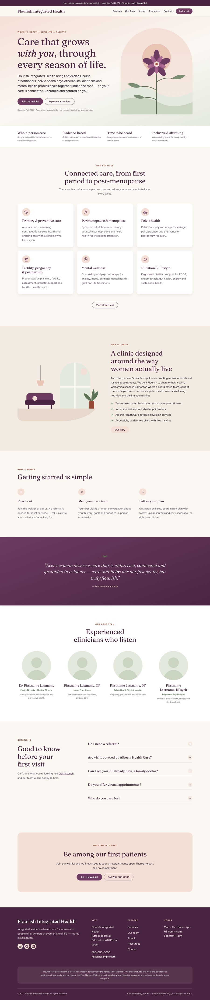
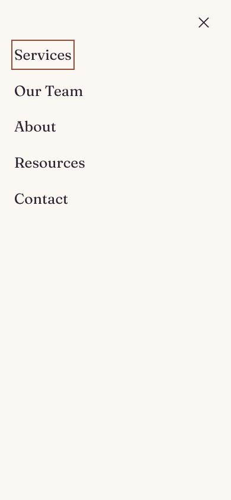

# Flourish Integrated Health — WordPress theme

A responsive block theme (Gutenberg / full site editing) for **Flourish Integrated Health**, a women's health clinic opening in Edmonton, Alberta in Fall 2027.

| Desktop | Mobile | Mobile menu |
|---|---|---|
|  |  |  |

## Install (WordPress Admin)

1. Download **[`dist/flourish.zip`](dist/flourish.zip)**.
2. In WordPress go to **Appearance → Themes → Add New Theme → Upload Theme**, choose `flourish.zip`, click **Install Now**, then **Activate**.
3. Go to **Settings → Permalinks** and choose **Post name** (the starter menu links use `/services/`, `/about/` and so on).
4. Create the pages **Services**, **Our Team**, **About**, **Resources** and **Contact**. For each one, open the block inserter → **Patterns → Flourish: Full pages** and insert the matching page pattern. For pages built entirely from patterns, choose the **Landing Page (no title, full width)** template.
5. Upload your logo in **Appearance → Editor → Patterns → Header** (Site Logo block), or under **Settings → General → Site Icon**.
6. Edit the menus, footer, hours, address and the announcement bar in **Appearance → Editor**.

To rebuild the zip after changing files: `bin/build-zip.sh`.

## Brand guideline status

**No brand guideline file reached this project.** The design system below is a placeholder built for a modern women's health clinic. Every brand value lives in `flourish/theme.json`, so applying the official guideline is a small edit:

| What to change | Where |
|---|---|
| Brand colours | `theme.json → settings.color.palette` (keep the slugs and change the hex values). Also update the hex values in `styles/*.json` and the colours in `assets/images/*.svg` |
| Fonts | Put the `.woff2` files in `assets/fonts/` and update `settings.typography.fontFamilies` |
| Corner radius, line heights | `settings.custom` |
| Type scale and spacing | `settings.typography.fontSizes`, `settings.spacing.spacingSizes` |

Most of these can also be changed without code in **Appearance → Editor → Styles**.

## Design system (placeholder)

**Concept:** growth, warmth and calm. Soft arches and botanical forms suggest opening and flourishing. The plum and sage pairing reads as caring and clinical without the usual "medical blue".

| Role | Name | Hex |
|---|---|---|
| Background | Linen | `#FBF7F2` |
| Alt background | Sand | `#F3EAE1` |
| Text | Ink | `#2B2130` |
| Secondary text | Dusk | `#6A5F6C` |
| Primary / buttons | Plum | `#6E3B61` |
| Headings, footer | Deep Plum | `#4A2541` |
| Secondary | Sage | `#5E7356` |
| Tint | Pale Sage | `#E3E9DD` |
| Accent (labels) | Clay | `#984A37` |
| Tint | Blush | `#F4DFD6` |

Text and background pairings meet WCAG 2.1 AA contrast.

- **Typography:** *Fraunces* (soft serif) for headings and *Figtree* (humanist sans) for body text. Both are self-hosted, with no Google Fonts requests, which matters for patient privacy.
- **Style variations:** Default (Plum & Linen), **Sage** and **Blush**. Switch them in **Editor → Styles**.
- **Responsive:** fluid type and spacing (`clamp()`), auto-fitting grids, columns that stack below 782px, a sticky header and a full-screen mobile menu. Tested at 1440px and 390px with no horizontal scrolling.
- **Accessibility:** visible focus rings, semantic landmarks (header, main, footer), alt text on informative images, decorative icons hidden from screen readers, and `prefers-reduced-motion` support.

## What's included

```
flourish/
├── style.css, theme.json, functions.php, readme.txt, screenshot.png
├── templates/   front-page, home, index, single, page, archive, search, 404,
│                page-landing (no title), page-sidebar-cta (sticky booking card)
├── parts/       header (sticky + mobile menu), footer, announcement bar
├── patterns/    hero, trust-bar, services-grid, welcome-split, approach-steps,
│                mission-quote, team-grid, faq, location-hours, cta-waitlist,
│                page-header, post-grid + full pages: home, services, about, contact
├── styles/      sage.json, blush.json
└── assets/      css/theme.css, fonts/ (Fraunces, Figtree + OFL licences), images/ (SVG illustrations + icons)
```

**Block styles** (in the block sidebar under *Styles*): Card, Rounded panel (Group); Arch, Organic (Image); Eyebrow, Lead (Paragraph/Heading); Checkmarks (List); Soft (Button); Sprig (Separator).

## Before launch: content to replace

- `[Street address]`, `[Postal code]`, `780-000-0000` and `hello@example.com` (footer, Location pattern, CTA).
- Practitioner names and photos (Care Team pattern), the hours, and the social media links.
- The map placeholder on the Contact page. Use an Embed or Custom HTML block.
- **Contact or waitlist form:** add one with a form plugin. Don't collect health details through website forms. Alberta's *Health Information Act* applies to clinic records.
- **Land acknowledgement** (footer): starter wording for Treaty 6 territory. Please have the clinic confirm the final wording.
- **Advertising rules:** CPSA (College of Physicians & Surgeons of Alberta) advertising standards restrict patient testimonials, so the theme uses a mission statement instead. Have the clinic review service claims before launch.

## Compatibility

Requires WordPress 6.7+ and PHP 7.4+, using `theme.json` schema v3. Before release it was tested by installing `flourish.zip` through WordPress's theme installer on a current WordPress 7.x development build. Every pattern, template and template part passes the block editor's validator, so none of them show "unexpected content" warnings.
